<p align="center">
  
</p>

<p align="center">
  <a href="mailto:amar.tiwari.8355@gmail.com"></a>
  <a href="https://www.linkedin.com/in/amar-tiwari26"></a>
  <a href="https://x.com/Tiwari__Amar"></a>
  <a href="https://cortex-sre.vercel.app"></a>
</p>

```yaml
role:     AI Engineer @ Communication Crafts · Ahmedabad, India (IST)
builds:   voice agents on live phone lines · agentic pipelines · production RAG
owns:     architecture → integrations → tracing → evals → deployment
open_to:  AI engineering roles · remote (worldwide) or Ahmedabad
```

## Systems I've shipped



- **The conversation is a graph.** Each edge on the visual canvas compiles into an LLM function call, so the agent moves between stages by reasoning about what the caller said, not by matching keywords.
- **Built for real phone lines.** Audio stays at 8 kHz end to end, providers can be swapped at every step, and the agent can call HTTP tools, search a multilingual knowledge base and fill structured fields after the call.
- **Production safeguards:** TRAI calling-hours enforcement, Twilio signature checks, and fallback when a provider fails mid-call. A carrier simulator replays the real Twilio and Exotel protocols so latency can be tested without a phone.

<sub>Private company product · walkthrough available on request</sub>

<br/>



- **Respects the sites it reads.** robots.txt is enforced in code, there are no stealth or CAPTCHA workarounds, and sources that block it pause themselves.
- **Claude research agents** look into each company (Apollo + web), score it on a 100-point ICP model with cited evidence, and draft an email and LinkedIn note for a rep to review.
- **Every step is traced:** each search, page, token and dollar, plus cost per sales-ready lead, with dry-run, controlled and full run modes. It started as my **2nd-place** internal Agentic AI Hackathon prototype, and I built it into production on my own.

<sub>Private company product · walkthrough available on request</sub>

<br/>



- **Hybrid retrieval:** per-tenant BM25 + dense search in Qdrant, fused with RRF, then two-stage cross-encoder reranking and parent-child chunk expansion.
- **PDF ingestion that adapts to the file:** a fast PyMuPDF path handles a 50-page manual in 1–3 s, and only scanned or messy pages go through YOLOX layout analysis and Tesseract OCR.
- **A full SaaS around it:** tenant isolation, two-level RBAC, plans and quotas, a super-admin console with an audit log, and RBAC-scoped delta sync to a React Native app that runs the whole pipeline on the phone.

<sub>Built in one month with a 2-person team · earned a WOW Card · <a href="https://github.com/Amar5623/hybrid-rag-chatbot">repo</a></sub>

## How I engineer

| | What it looks like in my work |
|---|---|
| **Architecture** | Multi-tenant isolation and 3 connectivity modes (MarineDoc), conversation graphs compiled to function calls (Voicely), a 6-agent DAG with parallel fan-out (Cortex) |
| **Integrations** | Twilio, Exotel, Sarvam, Deepgram, ElevenLabs, Apollo, Supabase, Upwork GraphQL, IMAP, plus the DataHub, Slack and CockroachDB MCP servers |
| **Tracing & monitoring** | Per-request trace IDs, token and cost tracing at each step, call transcripts with node and tool events, append-only audit logs |
| **Evaluation** | A carrier simulator for latency testing, dry-run → controlled → full rollout gates, PII safety reports on generated code, feedback and outcome analytics |
| **Guardrails** | A 15-category SQL-injection validator, sensitive-column filtering, least-privilege SQL roles for each agent, separate read-only and write MCP sessions |
| **Deployment** | Docker, AWS Lambda in 2 regions with SAM, Railway, Render, Vercel, EAS builds for Android |

## More builds

| Project | What it shows | Links |
|---|---|---|
| **Cortex** | A 6-agent LangGraph SRE swarm across 2 AWS regions. CockroachDB is its only memory: lease locks and fenced writes let it survive a region being killed mid-fix | [repo](https://github.com/Amar5623/cortex) · [live](https://cortex-sre.vercel.app) · [video](https://youtu.be/34qlBkwNzJU) |
| **PipelineGuard** | A DataHub MCP agent that writes dbt and Airflow code from real schema, lineage, PII tags and SLAs, then writes lineage back | [repo](https://github.com/Amar5623/Pipeline-Guard) |
| **StandupPilot** | A Slack agent that uses Slack MCP and the Real-Time Search API to check reported blockers against live conversations | [repo](https://github.com/Amar5623/standup-pilot) |
| **EZ-Insights** | NL-to-SQL with schema RAG, self-correcting retries and a 15-category SQL-injection validator for live production databases | [repo](https://github.com/Amar5623/ez-insights) |
| **Support Agent** | A 2-tier meta-tool design that keeps tool schemas at about 750 tokens per request, plus human-in-the-loop approvals over WebSockets | [repo](https://github.com/Amar5623/customer-support-agent) |

## Toolbox

<p>
  
</p>

**LLMs & agents** · LangGraph · LangChain · LangSmith · MCP · tool calling · evals · guardrails · Claude · OpenAI · Groq · Gemini<br/>
**Retrieval** · BM25 + dense (RRF) · cross-encoder reranking · hierarchical chunking · Qdrant · Pinecone · FAISS · sqlite-vec<br/>
**Voice** · Pipecat · Sarvam · Deepgram · ElevenLabs · Twilio · Exotel · WebRTC<br/>
**Mobile** · React Native (Expo) · ONNX Runtime on device

## Recognition

- 🥈 **2nd place**, internal Agentic AI Hackathon at Communication Crafts (2026)
- 🏅 **WOW Card** as an intern, for shipping MarineDoc in one month with a 2-person team
- 💰 **Bounty winner**, [Aptos NFT Marketplace dApp](https://github.com/Amar5623/Aptos-NFT-Marketplace-Bounty)

<br/>

<p align="center">
  <sub>Hiring for AI engineering, remote or in Ahmedabad? The quickest way to reach me is <a href="mailto:amar.tiwari.8355@gmail.com">email</a>.</sub>
</p>
